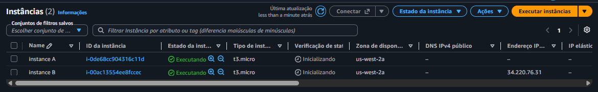
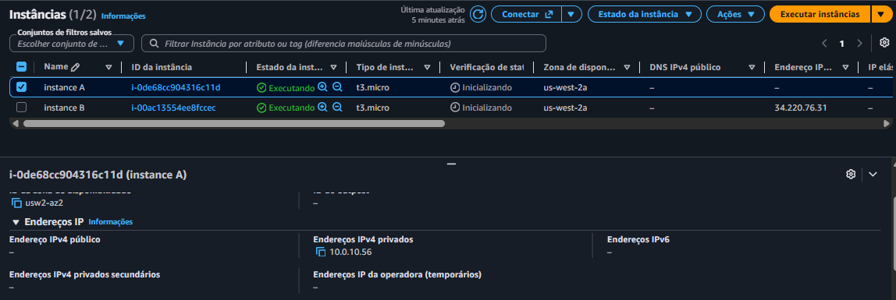
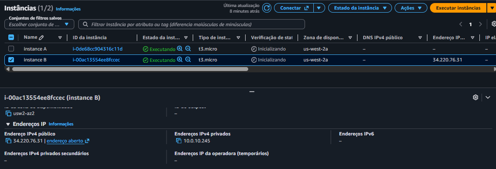
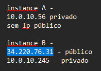
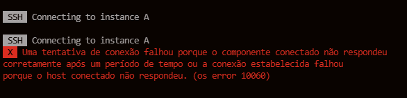
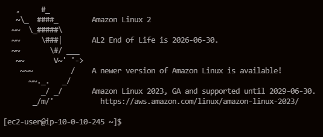
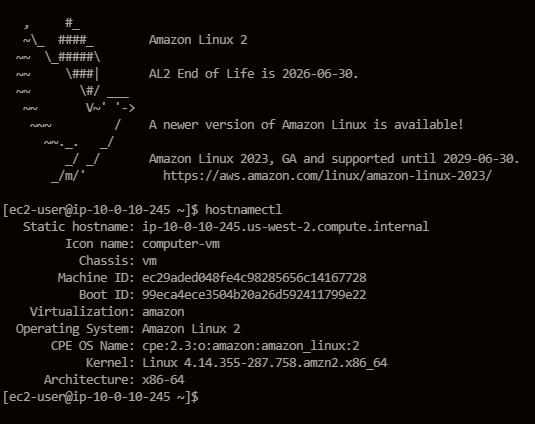

# Protocolos da Internet - Endereços IP Públicos e Privados

## Objetivo

Investigar um problema de conectividade em uma infraestrutura AWS, compreendendo a diferença entre endereços IPv4 públicos e privados em instâncias Amazon EC2.

---

## Cenário

Uma empresa possui uma VPC com CIDR `10.0.0.0/16` contendo duas instâncias Amazon EC2.

Apesar de estarem na mesma VPC e possuírem configurações semelhantes, apenas uma das instâncias consegue acessar recursos externos na Internet.

O objetivo deste laboratório foi identificar a causa do problema e propor a solução adequada.

---

# Evidências

## 1. Visão Geral das Instâncias EC2

---

## 2. Configuração de Rede da Instância A

---

## 3. Configuração de Rede da Instância B

---

## 4. Comparação dos Endereços IP

---

## 5. Tentativa de Conexão SSH na Instância A

---

## 6. Conexão SSH Bem-Sucedida na Instância B

---

## 7. Sessão SSH Ativa

---

# Análise

| Instância | IP Privado | IP Público |
|-----------|------------|------------|
| Instância A | ✅ | ❌ |
| Instância B | ✅ | ✅ |

Durante a investigação foi identificado que a Instância A possuía apenas um endereço IPv4 privado.

Por esse motivo, a instância não podia ser acessada diretamente da Internet.

A Instância B possuía um endereço IPv4 público associado, permitindo conectividade externa e acesso remoto via SSH.

---

# Conclusão

O problema apresentado pelo cliente estava relacionado ao tipo de endereçamento utilizado pela Instância A.

Endereços IP privados são destinados à comunicação interna dentro da VPC e não são roteáveis na Internet.

Para acesso externo direto, uma instância Amazon EC2 deve possuir um endereço IPv4 público ou utilizar soluções como NAT Gateway, Bastion Host ou VPN.

Também foi concluído que não é recomendável utilizar blocos de endereçamento público como CIDR principal de uma VPC. O ideal é utilizar intervalos privados definidos pela RFC 1918:

- 10.0.0.0/8
- 172.16.0.0/12
- 192.168.0.0/16

---

## Serviços Utilizados

- Amazon EC2
- Amazon VPC
- Internet Gateway (IGW)
- SSH
- Amazon Linux
- IPv4 Público
- IPv4 Privado
