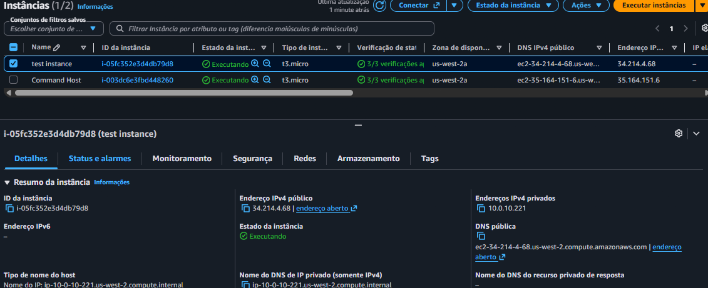
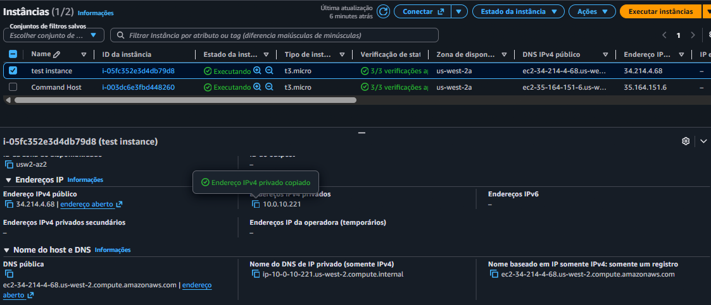
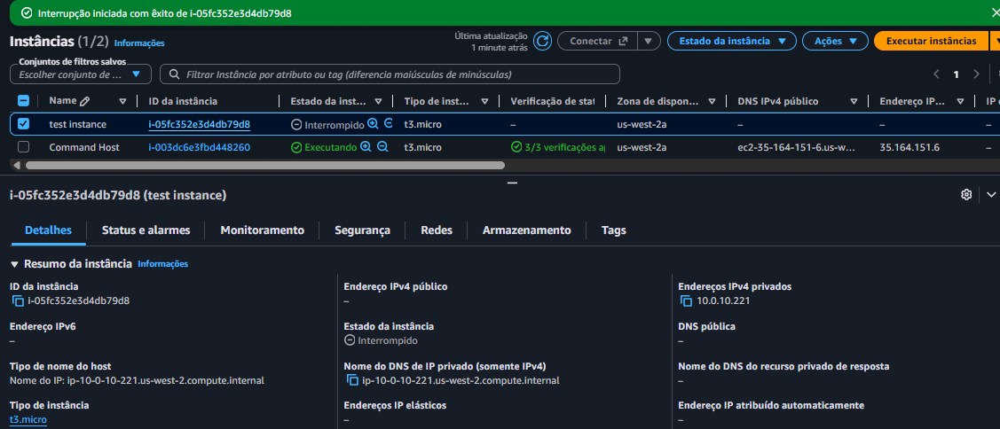
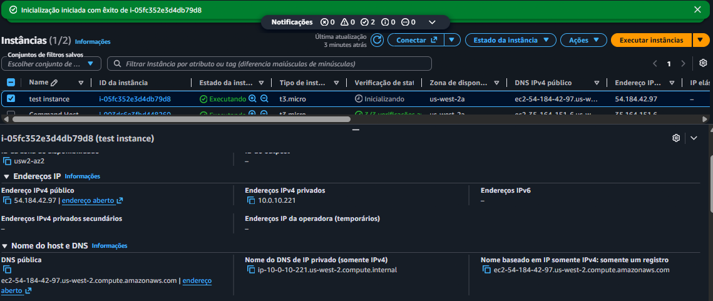
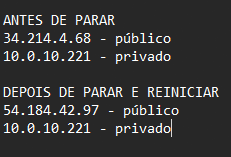
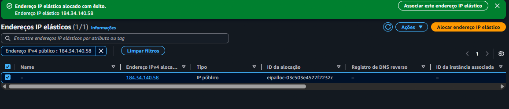
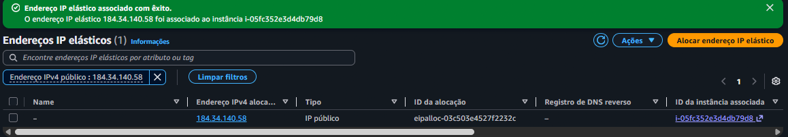
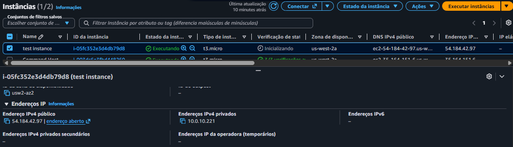
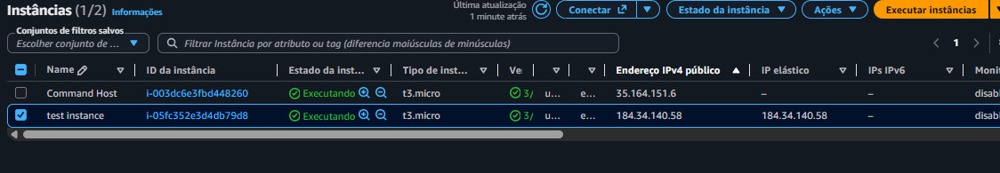

# 02 - IP Estático e Dinâmico em Instâncias EC2

## Descrição

Neste laboratório foi realizado um estudo sobre o funcionamento dos endereços IP em instâncias Amazon EC2, com foco na diferença entre endereços IP dinâmicos e estáticos.

O cenário simula um chamado de suporte em que um cliente relata que sua instância EC2 altera o endereço IP público toda vez que é interrompida e iniciada novamente, causando indisponibilidade em sistemas que dependem de um endereço fixo.

Para resolver o problema, foi implementado um Elastic IP (EIP), garantindo que o endereço IPv4 público permanecesse constante mesmo após reinicializações da instância.

---

## Objetivos

- Compreender a diferença entre IP público e privado.
- Identificar o comportamento de um IP dinâmico em uma instância EC2.
- Reproduzir o problema relatado pelo cliente.
- Criar um Elastic IP (EIP).
- Associar o Elastic IP à instância EC2.
- Validar a persistência do endereço IP após reinicializações.

---

## Serviços Utilizados

- Amazon EC2
- Amazon VPC
- Elastic IP (EIP)
- Security Groups

---

## Etapa 1 - Criação da Instância EC2

Foi criada uma instância Amazon Linux 2 do tipo t3.micro utilizando a VPC e a sub-rede pública do laboratório.

---

## Etapa 2 - Identificação dos Endereços IP

Após a criação da instância, foram identificados os endereços IPv4 público e privado atribuídos pela AWS.

---

## Etapa 3 - Parada da Instância

A instância foi interrompida para analisar o comportamento dos endereços IP após o desligamento.

---

## Etapa 4 - Reinicialização da Instância

Após iniciar novamente a instância, foi possível observar que o endereço IPv4 público foi alterado automaticamente pela AWS.

---

## Etapa 5 - Comparação dos Endereços IP

Foi realizada uma comparação entre os endereços IP antes e depois da reinicialização.

Resultado observado:

- O endereço IPv4 Público mudou.
- O endereço IPv4 Privado permaneceu o mesmo.

---

## Etapa 6 - Criação do Elastic IP

Foi criado um Elastic IP (EIP), recurso responsável por fornecer um endereço IPv4 público estático para instâncias EC2.

---

## Etapa 7 - Associação do Elastic IP

O Elastic IP foi associado à instância EC2 criada durante o laboratório.

---

## Etapa 8 - Elastic IP Associado

Após a associação, o endereço IPv4 público da instância passou a utilizar o Elastic IP.

---

## Etapa 9 - Validação da Solução

A instância foi novamente interrompida e iniciada para validar a persistência do endereço IP.

O Elastic IP permaneceu associado à instância, comprovando que o endereço agora é estático.

---

## Resultados Obtidos

Durante os testes foi possível constatar que:

- O IPv4 público atribuído automaticamente pela AWS é dinâmico.
- O IPv4 privado permanece inalterado dentro da VPC.
- O Elastic IP fornece um endereço IPv4 público estático.
- O Elastic IP continua associado à instância mesmo após interrupções e reinicializações.

---

## Conclusão

O problema relatado pelo cliente foi causado pela utilização de um endereço IPv4 público dinâmico atribuído automaticamente pela AWS. Como consequência, o endereço público era alterado sempre que a instância era interrompida e iniciada novamente.

A solução implementada consistiu na criação e associação de um Elastic IP (EIP), garantindo um endereço IPv4 público estático e persistente. Após a realização dos testes, foi comprovado que o enderea da Nuvem | AWS Cloud Computing
