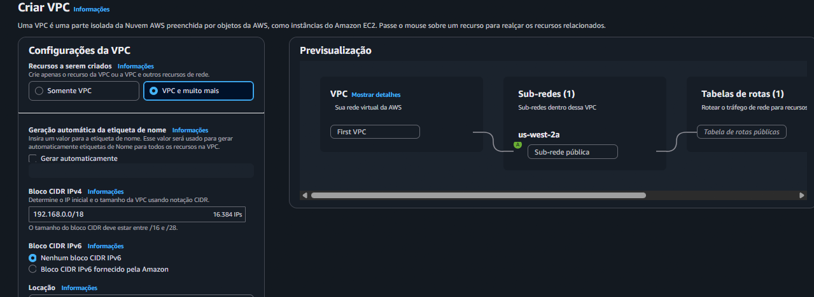
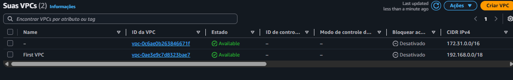
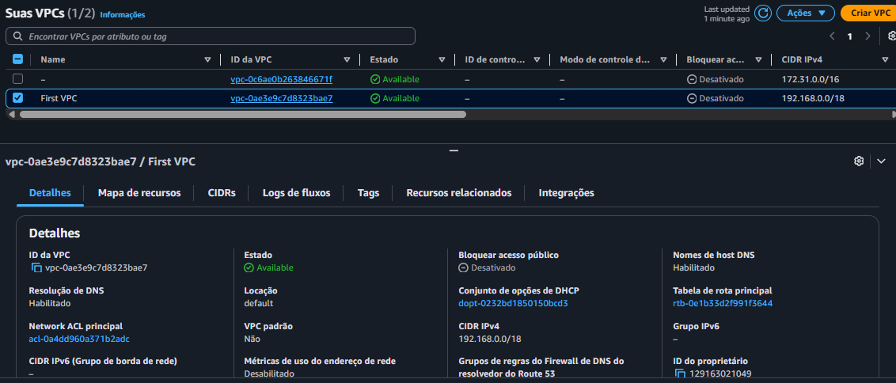

# 03 - Amazon VPC: Sub-redes e Endereçamento IP

## Descrição

Neste laboratório foi realizada a criação e configuração de uma Amazon Virtual Private Cloud (VPC), aplicando conceitos de endereçamento IP privado, blocos CIDR e segmentação de rede através de sub-redes.

O cenário simula um chamado de suporte em que um cliente solicita auxílio para configurar sua primeira VPC na AWS, garantindo uma faixa de aproximadamente 15.000 endereços IP privados e uma sub-rede pública capaz de suportar pelo menos 50 endereços IP.

Para atender aos requisitos, foi criada uma VPC utilizando um bloco CIDR privado da faixa 192.168.0.0/18 e uma sub-rede pública configurada com o bloco 192.168.1.0/26.

---

## Objetivos

- Compreender o conceito de Amazon VPC.
- Identificar faixas de endereços IP privados válidas.
- Aplicar conceitos de subnetting utilizando CIDR.
- Criar uma VPC na AWS.
- Configurar uma sub-rede pública.
- Validar a criação da infraestrutura de rede.

---

## Serviços Utilizados

- Amazon VPC
- Subnets (Sub-redes)
- IPv4
- CIDR

---

## Etapa 1 - Configuração da VPC

Foi configurada uma Amazon VPC utilizando um bloco CIDR privado capaz de atender ao requisito de aproximadamente 15.000 endereços IP.

### Configurações utilizadas

| Recurso | Configuração |
|----------|-------------|
| Nome da VPC | First VPC |
| CIDR da VPC | 192.168.0.0/18 |
| IPv6 | Desabilitado |
| Nome da Sub-rede | Sub-rede pública |
| CIDR da Sub-rede | 192.168.1.0/26 |

---

## Etapa 2 - Criação da VPC

Após a definição das configurações, a VPC foi criada juntamente com os recursos de rede necessários para seu funcionamento.

---

## Etapa 3 - Validação da Infraestrutura

Foi realizada a validação da VPC criada, confirmando o nome configurado, o bloco CIDR atribuído e o status disponível do recurso.

---

## Resultados Obtidos

Durante o laboratório foi possível constatar que:

- O bloco CIDR 192.168.0.0/18 disponibiliza aproximadamente 16.384 endereços IP.
- A faixa utilizada pertence aos endereços privados definidos pela RFC 1918.
- A sub-rede pública configurada com o bloco 192.168.1.0/26 disponibiliza 64 endereços IP.
- A Amazon VPC permite o isolamento lógico de recursos dentro da AWS.
- O planejamento correto do endereçamento IP é fundamental para garantir escalabilidade do ambiente.

---

## Conclusão

O laboratório permitiu compreender na prática como criar e configurar uma Amazon VPC na AWS utilizando blocos CIDR e sub-redes para atender requisitos específicos de endereçamento IP.

Além da implementação da infraestrutura, a atividade reforçou conceitos fundamentais de redes em computação em nuvem, como segmentação de rede, utilização de endereços privados e planejamento de capacidade para ambientes escaláveis.
