# Roteamento e Conectividade em uma Amazon VPC

## Objetivo

Criar uma infraestrutura de rede funcional na AWS utilizando uma Amazon VPC, configurando os recursos necessários para permitir a comunicação entre uma instância EC2 e a Internet.

---

## Cenário

Uma startup entrou em contato com o suporte da AWS informando que sua infraestrutura de rede não possuía conectividade com a Internet. Apesar de possuir uma VPC criada, a comunicação externa não funcionava corretamente.

O objetivo deste laboratório foi criar e configurar todos os componentes necessários para tornar a VPC roteável, incluindo sub-rede pública, tabela de rotas, Internet Gateway, Network ACL, Security Group e uma instância Amazon EC2 para validação da conectividade.

---

# Evidências

## 1. VPC Criada

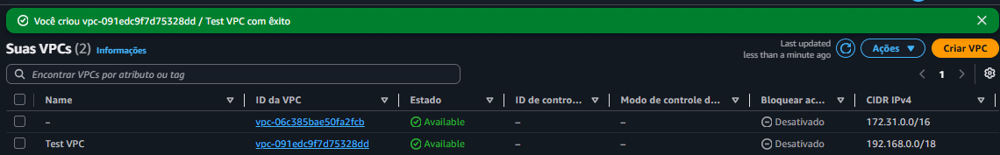

---

## 2. Sub-rede Pública Criada

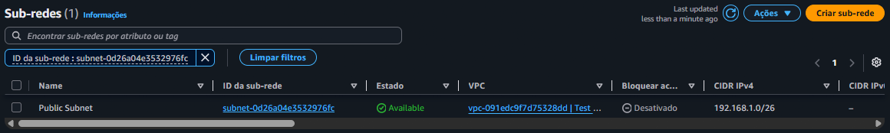

---

## 3. Tabela de Rotas Criada

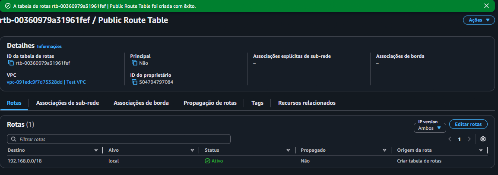

---

## 4. Internet Gateway Criado

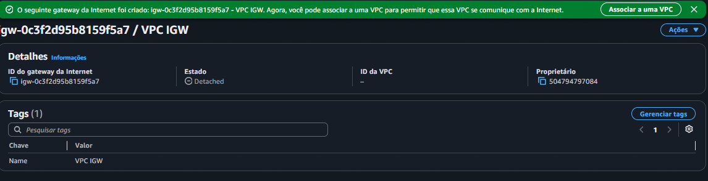

---

## 5. Internet Gateway Associado à VPC

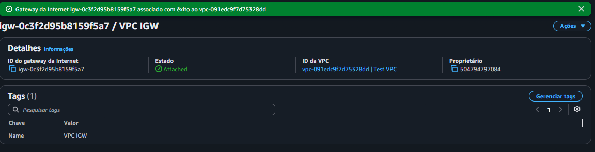

---

## 6. Rota para a Internet Configurada

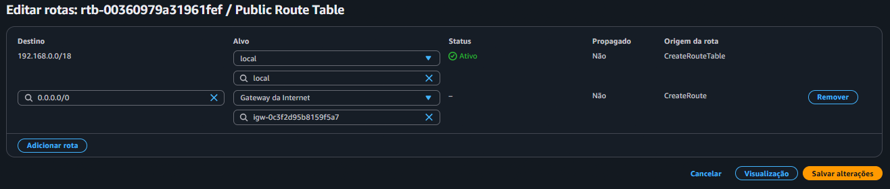

---

## 7. Associação da Sub-rede à Tabela de Rotas

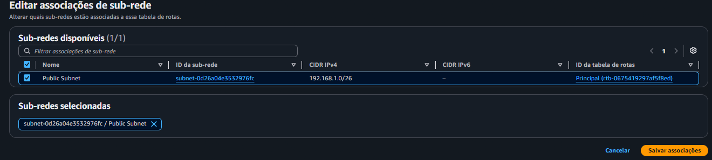

---

## 8. Network ACL Criada

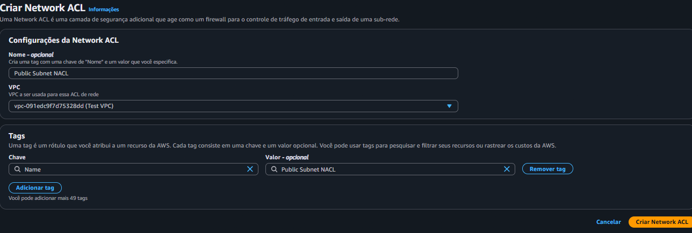

---

## 9. Regra de Entrada da NACL

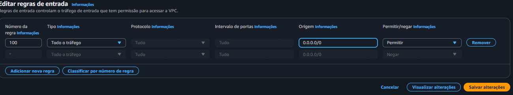

---

## 10. Regra de Saída da NACL

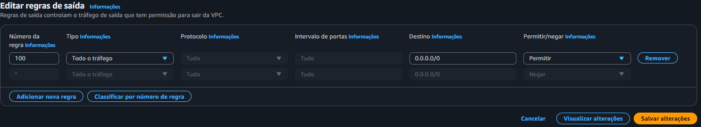

---

## 11. Associação da NACL à Sub-rede

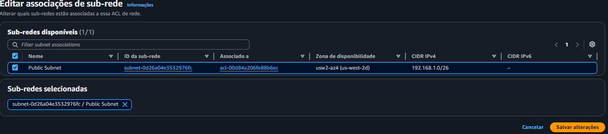

---

## 12. Security Group Configurado

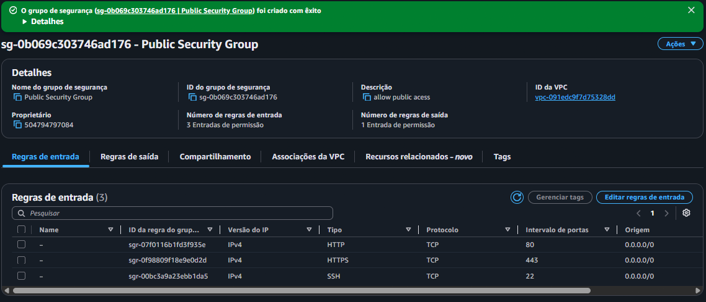

---

## 13. Instância EC2 em Execução

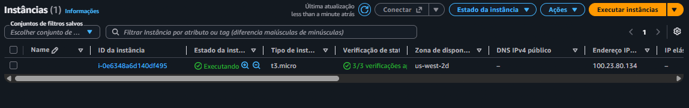

---

## 14. Teste de Conectividade com a Internet

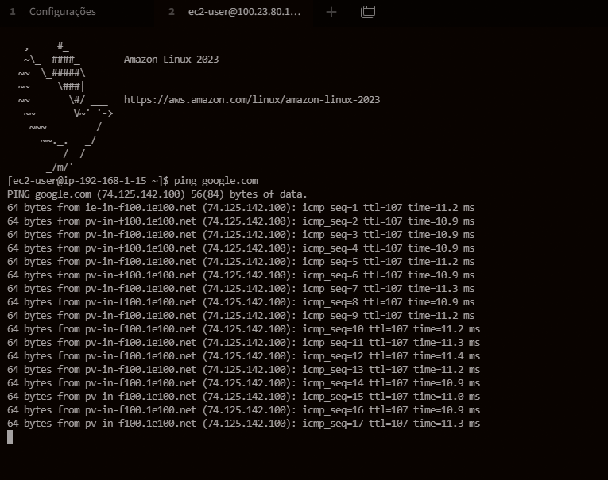

---

# Análise

Durante a implementação da solução foi necessário configurar todos os componentes responsáveis pela conectividade e segurança da rede.

| Recurso | Finalidade |
|----------|------------|
| Amazon VPC | Ambiente de rede isolado |
| Sub-rede Pública | Hospedagem da instância EC2 |
| Route Table | Direcionamento do tráfego |
| Internet Gateway | Acesso à Internet |
| Network ACL | Controle de tráfego na sub-rede |
| Security Group | Firewall da instância |
| Amazon EC2 | Validação da conectividade |

A rota padrão `0.0.0.0/0` foi adicionada à tabela de rotas e apontada para o Internet Gateway, permitindo que o tráfego destinado à Internet pudesse sair da VPC.

Além disso, as regras da Network ACL foram configuradas para permitir tráfego de entrada e saída, enquanto o Security Group permitiu conexões SSH, HTTP e HTTPS.

A validação final foi realizada através do comando:

```bash
ping google.com
```

O recebimento das respostas confirmou que a instância EC2 possuía conectividade com a Internet e que a configuração da infraestrutura estava correta.

---

# Conclusão

O problema apresentado pelo cliente foi solucionado através da criação de uma arquitetura de rede completa dentro da Amazon VPC.

O laboratório demonstrou na prática a importância do relacionamento entre VPC, sub-redes, tabelas de rotas, Internet Gateway, Network ACLs e Security Groups para o funcionamento da comunicação de rede na AWS.

Ao final, a instância EC2 conseguiu acessar recursos externos com sucessoux 2023
- SSH
- ICMP (Ping)
- IPv4
