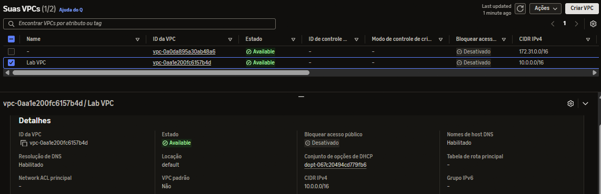
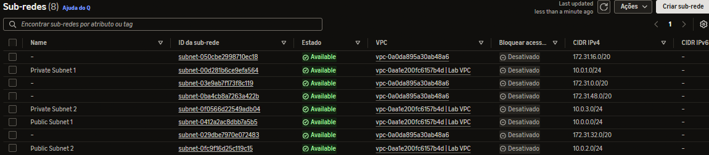
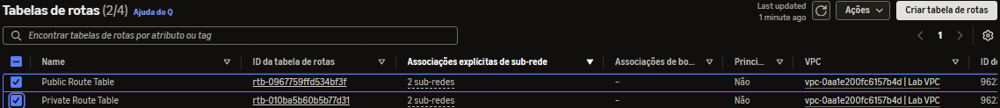
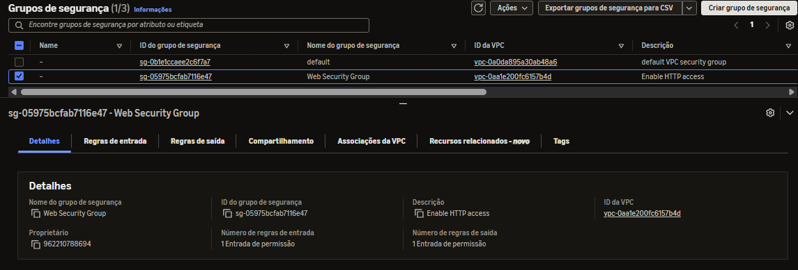
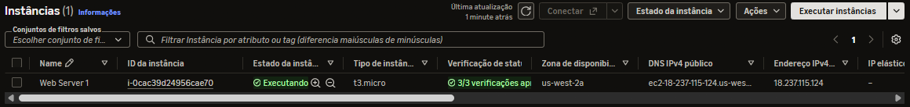
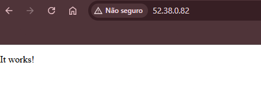

# Laboratório AWS: Criação de VPC Customizada e Lançamento de Servidor Web

Este repositório documenta a execução bem-sucedida do laboratório prático da AWS que consiste na criação de uma arquitetura de nuvem isolada e segura, contendo uma Virtual Private Cloud (VPC), sub-redes públicas e privadas, tabelas de rotas, gateways e o lançamento de uma instância EC2 operando como servidor web.

---

##  Arquitetura e Estrutura do Laboratório

### 1. Criação da VPC e Componentes de Rede
Configuração inicial da VPC (`Lab VPC`) definindo o bloco CIDR principal para isolar os recursos de rede, além da criação e associação do *Internet Gateway* para permitir a comunicação com a internet externa.

### 2. Configuração das Sub-redes (Subnets)
Divisão da VPC em sub-redes distribuídas em múltiplas Zonas de Disponibilidade (AZs), contemplando sub-redes públicas (para recursos acessíveis externamente) e privadas (para maior segurança de dados internos).

### 3. Tabelas de Rotas e Associação de Gateways
Criação e configuração da tabela de rotas pública, garantindo que o tráfego destinado à internet (`0.0.0.0/0`) seja direcionado corretamente para o *Internet Gateway*.

### 4. Criação do Grupo de Segurança (Security Group)
Definição das regras de firewall da camada de rede, liberando o tráfego de entrada na porta **80 (HTTP)** para permitir o acesso público à aplicação web.

### 5. Lançamento da Instância EC2
Provisionamento de uma máquina virtual na AWS baseada em Amazon Linux, alocada na sub-rede pública e associada ao grupo de segurança correspondente para hospedar o servidor web.

### 6. Validação do Servidor Web
Teste de acesso final via navegador web utilizando o endereço IP/DNS público da instância EC2, confirmando que o servidor Apache e a aplicação do laboratório estão rodando perfeitamente.

---

##  Tecnologias Utilizadas
* **Amazon VPC** (Virtual Private Cloud)
* **Amazon EC2** (Elastic Compute Cloud)
* **Servidor Web Apache (HTTPd)**
* **Redes AWS** (Internet Gateways, Route Tables, Subnets, Security Groups)

---

> *Documentação elaborada como evidência prática de estudos de infraestrutura de nuvem na AWS.*
